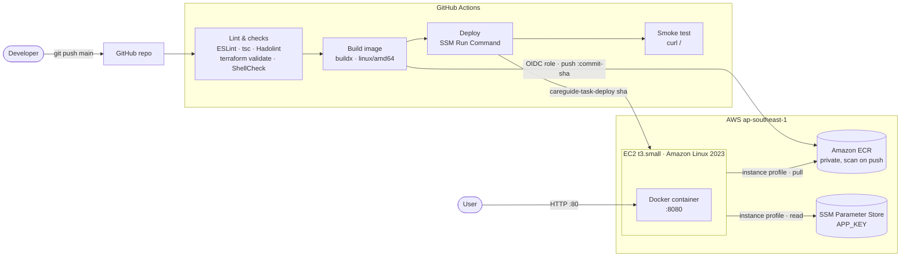

# careguide-task

A minimal AdonisJS (Node.js 24) API, containerized and deployed to AWS EC2 through GitHub Actions.

```
GET /  →  {"message":"Hello from DevOps Intern Task!","status":"running"}
```

## Repository layout

```
apps/backend/              AdonisJS API
Dockerfile                 Multi-stage build, node:24-slim, non-root user
docker-compose.yml         Runs the app on port 8080
.github/workflows/ci.yml   Lint → build & push to ECR → deploy to EC2
infra/                     Terraform for ECR, EC2 and IAM (see infra/README.md)
scripts/system_health.sh   System health logger
```

## Run the app with Docker Compose

Requirements: Docker with Compose, and port 8080 free.

```bash
cp .env.example .env
docker compose up --build
```

With the standalone Compose v1 binary, run `docker-compose up --build` instead.

Then, in another terminal:

```bash
curl http://localhost:8080/
```

Press `Ctrl+C` to stop, then run `docker compose down`.

## Run the Bash script

The script runs on Linux only (it reads `/proc`).

```bash
chmod +x scripts/system_health.sh
./scripts/system_health.sh
```

It appends a timestamped line with CPU, memory and disk usage to `scripts/health_log.txt`:

```
2026-11-07 11:24:48 | CPU: 1.7% | Memory: 6.8% | Disk (/): 85%
```

If disk usage is above 80%, it also prints `[WARNING] Disk space high!`.

## CI/CD workflow



Pull requests to `main` run lint and build only. Pushes to `main` also push the image to ECR and deploy it.

## How would you deploy this container to AWS?

- **Build once, push to a private registry.** CI builds the image, tags it with the commit SHA and pushes it to Amazon ECR. It uses a short-lived GitHub OIDC role, so no AWS keys are stored in GitHub.
- **Run it on a locked-down EC2 instance.** The instance allows only HTTP in and HTTPS out, and has no SSH. Its IAM instance profile can only pull from that repository and read the app's secret from SSM Parameter Store.
- **Deploy with SSM Run Command, then verify.** CI tells the instance to pull the new tag and restart the container, then checks `/`. To go further: an ALB with HTTPS and an Auto Scaling group, or ECS Fargate.
